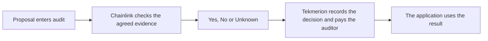

# Chainlink as a Tekmerion auditor

Tekmerion lets an application appoint auditors to check whether a proposed
result follows the rules agreed by its participants. The auditor can be a
human committee or an automated reviewer using AI and Chainlink. In both
cases, Tekmerion enforces the review deadlines, decision and payments.

The integration includes a working local test path. Each review setup fixes
its delivery channel in advance. Before relying on a live setup, verify its
operator and execution guarantees; creating it does not provide that assurance.

## Who does what

**The application** defines the question and the rules before participants
rely on them. It presents the proposal and later uses the accepted result.

**Chainlink and the AI researcher** check the proposal against those rules and
the permitted evidence. Chainlink delivers the review answer to Tekmerion.
The integration counts as one appointed auditor, rather than giving each
Chainlink node a separate vote.

**Tekmerion** holds the review funds, accepts only the appointed auditor's
answer and enforces the agreed financial outcome. The application's operator
does not receive the auditor's voting rights.

## How an audit starts

An author chooses one of two review methods when submitting a new proposal:

- **Challenge:** the author posts a bond. Other participants can fund a
  challenge; reaching the agreed target starts the audit.
- **Direct audit:** the author pays only the audit fee. Review starts
  immediately, without a bond or a challenge-funding period.

A challenge that remains underfunded can be accepted after its funding window
without an audit. This is optimistic acceptance, not a Chainlink-verified
answer. A paid direct audit always requires the auditor's decision.

The application determines who can submit a proposal and when. Paying for an
audit does not bypass those access rules or convert an existing challenge.

## From proposal to decision

1. The review is tied to the original Agreement and the author's proposed
   Result. These documents cannot be replaced during that review.
2. The workflow checks that it is using the agreed review rules and documents,
   then asks the AI researcher to assess the claim. The current researcher
   uses OpenAI. Web research is available only when allowed in advance.
3. The researcher compares the claim with the Agreement and the permitted
   sources. Documents and web pages are evidence; they cannot rewrite the
   auditor's instructions or grant extra research tools.
4. Chainlink delivers the decision and the fingerprint of a final written
   report. Tekmerion accepts the answer only through the appointed auditor.
5. The delivered answer must be applied before the review deadline. Anyone
   can perform this step without the platform administrator's permission.
   The resulting decision and auditor payment take effect together.

## What the answer means

- **Yes:** the evidence supports the proposed result under the Agreement.
- **No:** the evidence establishes a contradiction with the Agreement.
- **Unknown:** the available permitted evidence is insufficient or conflicting.

Unknown is a completed audit. For a direct audit, Yes, No and Unknown all earn
the prepaid fee. If the review times out without a decision, the author can
reclaim that fee. Challenge bonds and contributions follow the ordinary
[Tekmerion payment rules](how-it-works.md#where-the-money-goes).

A confirmed temporary technical failure can allow another execution, within
the attempt limit agreed in advance and the original deadline. A completed
Yes, No or Unknown cannot be rerun within the same case. A fresh proposal is a
separate paid case and must follow the application's submission rules.

## The final report

The report is a readable Markdown document. It contains the verdict, an
assessment of the Agreement's criteria, the findings and supporting links,
and references identifying the review. It is a final explanation, not a copy
of the agent's full conversation or every page it consulted.

A digital fingerprint of the exact report is recorded on-chain. Anyone with
the document can check that it matches the recorded version. Publishing the
report to the archive is optional: an unavailable archive does not block the
decision, although participants may then be unable to download its explanation.

## Write rules an auditor can apply

An Agreement should identify the exact subject, what counts as completion,
trusted sources, timestamp convention and treatment of missing or conflicting
evidence. The selected auditor must be permitted to reach those sources.
For an IPO, distinguish a completed offering from an announcement and identify
the company, instrument and official records.

Fixed documents protect the agreed wording. They do not prove that a source
or an AI interpretation is correct. Read
[how the review is verified](confidential-auditor.md) for the safeguards,
recovery rules and remaining trust assumptions.
