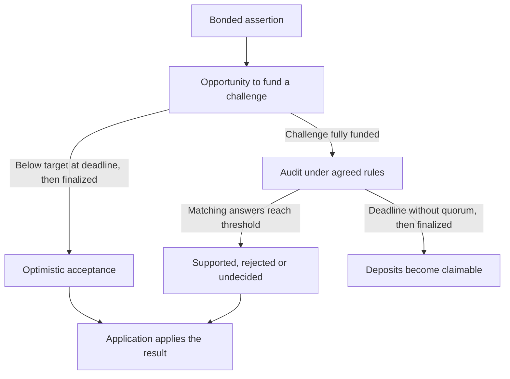

# Tekmerion concept

Tekmerion is a reusable protocol for assertions that may need independent review. It brings together a bonded statement, an opportunity to challenge it, an agreed audit process and a result that another application can use.

For a visual walkthrough of funding, auditor decisions and payments, see [how Tekmerion works](how-it-works.md).

## The problem and the people it serves

An application can have clear rules for what to do once a fact is known, while establishing that fact still requires interpretation. Sources may be incomplete, contradictory or worded differently. Relying on an application's operator to settle every disagreement can leave users uncertain about how the answer was chosen.

Tekmerion serves application builders who need a defined review process, authors willing to back their statements, and participants who want a way to challenge them. The application defines the question and the acceptable evidence before the result is known.

## Basic flow

1. With the configured client authority's approval, an author submits an assertion and commits a bond under the agreed rules.
2. Other participants have an opportunity to contribute toward a challenge.
3. If the challenge does not reach the required funding by the deadline, anyone can finalize the assertion as accepted through the optimistic path. Acceptance follows from the absence of a fully funded challenge; no audit is triggered.
4. A fully funded challenge receives independent audits under the agreed policy. Each appointed auditor can support the assertion, reject it or report that the evidence is insufficient to decide.
5. Matching answers must reach the policy's threshold, such as two of three or three of five auditors. The deciding vote records the final result and pays the auditors who formed that quorum. The application applies that result to its own operation and remains responsible for its own users' funds.

## How funds are used

The author's bond and challenge contributions support the review process. Contributions fund a challenge; auditors' signed answers determine the result.

On the optimistic path, finalization makes the author's bond and accepted challenge contributions claimable in full without an audit fee. After an audit, the result determines who bears the agreed audit fee and how the bonded funds are allocated. A successful challenge entitles challengers to their contributions and a share of the losing author's collateral after the fee, proportional to their accepted contributions. The [payment example](how-it-works.md#where-the-money-goes) shows how the outcome changes who receives the deposits.

The audit fee is split equally among the auditors whose matching answers formed the quorum. Each auditor has a configured fee wallet. Remaining base units are distributed one each among quorum members in policy order, so individual shares differ by at most one base unit. The deciding vote and all fee transfers succeed together; a failed transfer leaves the vote retryable.

An undecided answer does not prove that the author was wrong, but a quorum for that answer still earns the audit fee. A deadline reached without a quorum lets anyone finalize a timeout, making the review deposits claimable in full without an audit fee. Review funds remain separate from the application's own principal.

Authors and challengers use the same withdrawal operation after finalization. Each signs for their own stake receipt; the contract determines the role and amount from the Case and receipt, then records the withdrawal to prevent a second payment.

## What the result means

The review mechanism uses independent auditors appointed before a case begins. The policy supports one to nine auditors and requires a strict majority threshold, including a single-auditor policy. Each auditor signs an answer and reason for the selected Case. Each has one immutable vote; agreement concerns the answer, while individual reasons remain available. Policy rules are permanently locked after the first Case or explicit acquisition by the client authority.

The quality of the sources, the independence of the appointed auditors and the correctness of their interpretation remain part of the review process. A signed answer identifies its auditor; it does not guarantee that a judgment is correct.

Tekmerion provides an assertion-review result. The application decides what that result means for its own process, including whether to continue, reject a request or follow an unresolved-outcome path.

## Following an assertion as a participant

The author sees the assertion enter its challenge window after posting a bond. Challengers can contribute during that window and follow the funding progress. If the challenge stays below its target, anyone can finalize it after the deadline; participants then claim their review funds and the application can accept the assertion optimistically. If it reaches the target, participants follow the audit and then claim what the result entitles them to under the agreed rules.

A rejected, undecided or timed-out assertion can lead to a fresh paid attempt when the application allows one. The new Case links back to the completed previous Case, keeping the history understandable. An accepted Yes, including optimistic acceptance, prevents another attempt in the same Policy/subject chain. Each permitted attempt follows the same process shown in Basic flow, with its own bond, one challenge window and at most one audit. Earlier results and unpaid claims remain available; an old answer cannot stand in for the current one. The application controls whether another attempt is allowed and protects any result it has already made final.
