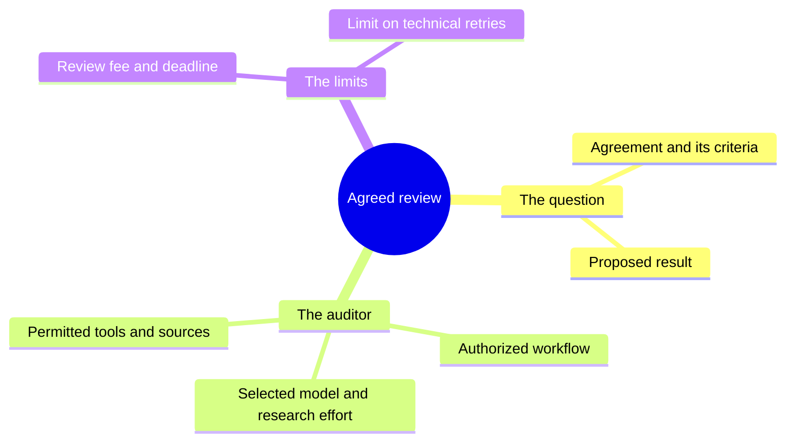

# How the Chainlink audit is verified

The purpose of this integration is to let participants rely on an agreed
auditor instead of the website operator's own judgment. Tekmerion controls
which auditor may answer and how its decision affects review funds. Chainlink
runs the automated review and delivers its answer through an authenticated path.

For the submission and payment flow, start with
[Chainlink as a Tekmerion auditor](chainlink.md).

## What is fixed before review

The selected auditor's rules are agreed before they are used. A review cannot
silently switch to another researcher, another set of tools or another proposal.

Each case is tied to the exact Agreement and Result documents. The auditor's
research permissions and execution limits are fixed as well. Changing the
auditor's terms requires a new set of review rules; it does not alter reviews
already using the old ones.

## How the correct task reaches the researcher

The service starts a review by pointing to the case. It does not supply a new
prompt, model choice or suggested verdict with that request.

The workflow reads the authoritative review records from Solana and checks
that they match the appointed auditor. It then records which execution is
handling the task. AI work starts only after this claim has been confirmed
on-chain, so competing executions cannot both take the same attempt.

The workflow retrieves the Agreement and Result from IPFS and checks their
fingerprints against the originals committed to the case. A substituted or
modified document cannot become the accepted input. If the required documents
cannot be obtained, the review follows its technical-failure rules.

The verified text is given to the researcher under the workflow's fixed
instructions. The Agreement tells it what facts to establish. It cannot grant
new tools, change the output rules or turn source text into instructions.

## How the answer becomes a decision

Chainlink delivers an authenticated answer identifying the case and execution
that produced it. The receiving contract checks the authorized delivery source,
appointed workflow, task identity, current attempt and deadline.

A delivered answer is retained until someone applies it to Tekmerion. Anyone
can do this without the platform administrator's key. Tekmerion then checks
the auditor's authority and finalizes the decision and fee payment together.
Repeating the same successful application cannot charge the fee twice.

The final written report has its own fingerprint recorded alongside the
answer. Participants can compare a downloaded report with that commitment.
Archiving happens after delivery; an archive outage cannot change a decision
that has already arrived.

## Failures and repeated attempts

A temporary technical failure, such as an unavailable provider, can permit
another attempt only when it is reported through the authenticated review
path. The retry limit and the original review deadline still apply.

A backend error or missing acknowledgement alone does not authorize a new AI
run. A completed Yes, No or Unknown is a substantive answer and cannot be
retried within that case. This prevents the operator from repeatedly asking
until it obtains a preferred answer.

If execution stops without a confirmed failure, or no decision is applied in
time, the ordinary Tekmerion timeout rules apply. A direct-audit author can
then reclaim the fee. A new proposal remains possible only under the
application's submission rules and requires its own payment.

## What participants are trusting

The delivery channel is selected before the review setup is used and cannot
be replaced for that setup. Participants must trust its operator. A custom
channel can pass the same authentication checks without being operated by
Chainlink; creating a setup does not certify its independence.

These checks bind a delivered answer to the selected workflow, original task
and current execution. The backend's ordinary service permissions do not let
it replace that task or cast the auditor's vote. Independent participants can
prepare review tasks and apply delivered answers.

The blockchain does not repeat the AI request or prove what happened inside
the AI provider. The qualified workflow is trusted to verify the documents,
follow the agreed research restrictions and interpret the response. Inference
and hosted web research run at the AI provider, outside Chainlink's
confidential environment.

An authenticated answer is not proof that every source is truthful or that
the model interpreted it correctly. Source selection and auditor quality still
matter. Independent access also does not guarantee that Chainlink, the model
provider or document storage will always be available.

## Local verification and release qualification

The repository includes a working local implementation and reproducible tests.
They exercise real local contracts, recorded research and authenticated delivery
using synthetic Chainlink identities. They establish local interoperability;
they do not establish live confidential execution or model accuracy.

The review setup fixes its delivery channel and workflow before it is used.
Before live use, verify who operates that channel, the real workflow identity,
confidential execution, secret handling, failure recovery and enough time to
apply a decision. Creating a setup or running local tests does not certify
those properties.
