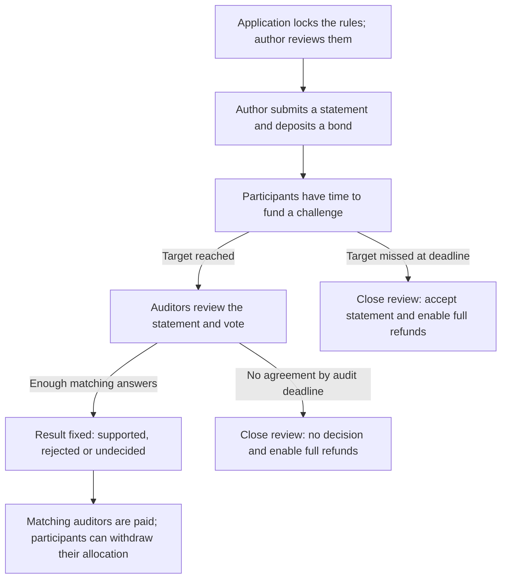
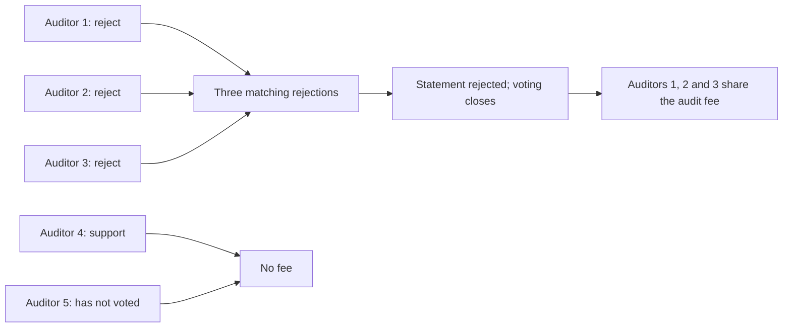
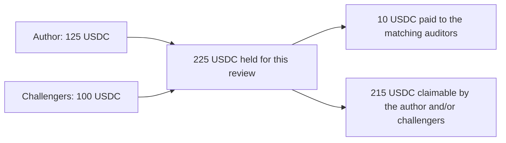

# How Tekmerion works

An author backs a statement with money. Other participants can pool money to challenge it. If the challenge is fully funded, appointed auditors decide the outcome. The contract holds the deposits, checks that everyone follows the agreed rules, and distributes the money according to the result.

The application defines the statement and chooses the auditors. Auditors review the evidence outside the contract. The contract verifies their signed decisions and enforces the financial outcome; the application then uses that result in its own process.

## From a statement to a result

Before participants commit funds, the rules define the minimum author deposit, challenge target, auditors, required number of matching answers, fee and deadlines. The application locks the rules and presents the locked terms to the author before asking for a deposit. Until that lock, the administrator can still revise them; afterward, they cannot be changed.

The audit starts as soon as the challenge reaches its target and has its own fixed time limit from that moment. For example, if 70 of the required 100 USDC is collected and someone offers 50, the contract accepts only 30. Further contributions stop when the target is reached. Until the review ends, deposits remain locked.

An underfunded challenge leads to acceptance after the funding deadline and an explicit closing action. Auditors have not verified the statement in this path. Deadlines never send money by themselves: anyone can close an expired review, and each participant then requests their withdrawal.

## How auditors reach a decision

Each appointed auditor gets one signed, unchangeable vote: **support**, **reject**, or **unable to decide from the evidence**. The threshold requires a majority of the appointed committee: for example, 1 of 1, 2 of 3, or 3 of 5. The amount of money contributed does not affect voting power.

Here is a 3-of-5 review at the moment the third rejection arrives:

The deciding vote ends the review immediately; the remaining auditors do not need to vote. Only the auditors whose matching answers formed the threshold share the fee equally, with tiny rounding differences where needed. Their reasons can differ as long as their answers match.

Agreement that the evidence is inconclusive is a completed audit and earns a fee. Failure to reach any agreement before the deadline earns no fee and leaves the statement unresolved. This also applies when everyone voted but the answers are split below the threshold.

## Where the money goes

Each review keeps its funds separate. The full amount deposited by the author is at risk, even if it exceeds the minimum. Challenge participants receive shares based on their accepted contributions.

For example, the author deposits **125 USDC**, challengers together deposit **100 USDC**, and the agreed audit fee is **10 USDC**. When auditors reach agreement, the pool is split as follows:

| Outcome                                              | Author can withdraw | Challengers can withdraw together | Auditor fee |
| ---------------------------------------------------- | ------------------: | --------------------------------: | ----------: |
| Statement supported                                  |                 215 |                                 0 |          10 |
| Statement rejected                                   |                   0 |                               215 |          10 |
| Evidence inconclusive                                |                 115 |                               100 |          10 |
| No agreement before the deadline, then review closed |                 125 |                               100 |           0 |

All amounts are USDC. When the statement is rejected, challengers recover their deposits and share the author's bond after the fee. Contributions of 40 and 60 USDC would therefore receive 86 and 129 USDC. If the evidence is inconclusive, challengers recover their deposits and the author pays only the audit fee.

If the challenge instead stops at 40 USDC and is closed after its funding deadline, the author can reclaim 125 and the challengers can reclaim their 40. There is no audit fee.

Auditor payments happen together with the deciding vote. If one payment fails, the entire deciding step is cancelled, including that vote, and can be retried before the deadline. Authors and challengers withdraw separately after the review ends. Each person can collect their allocation only once.

## What the contract checks

| Moment                    | Checks enforced by the contract                                                                                                                  |
| ------------------------- | ------------------------------------------------------------------------------------------------------------------------------------------------ |
| Starting a review         | The application authorizes it, the author agrees, and the required bond is actually deposited.                                                   |
| Accepting a contribution  | Funding is still open, the contributor is not the author, and only the remaining amount needed is collected.                                     |
| Accepting a vote          | The challenge is fully funded, the sender is an appointed auditor, that auditor has not voted before, and the audit voting window is still open. |
| Deciding the outcome      | Enough auditors gave the same answer. A finished result cannot be changed.                                                                       |
| Closing an expired review | Its relevant deadline has been reached and no earlier decision has already ended it.                                                             |
| Paying people             | The money is available, each payment goes to its entitled recipient, and the same entitlement cannot be paid twice.                              |

These checks enforce the agreed process. The auditors assess the evidence; the application is responsible for selecting independent reviewers and defining what a decision means for its users.

After rejection, an inconclusive audit or a timeout, the application may authorize a new attempt with fresh deposits. Previous withdrawals remain available. An accepted statement ends that sequence of attempts under the same rules.

For the purpose behind the mechanism, see the [concept](concept.md). Implementation details belong in the [program reference](../programs/tekmerion/README.md).
